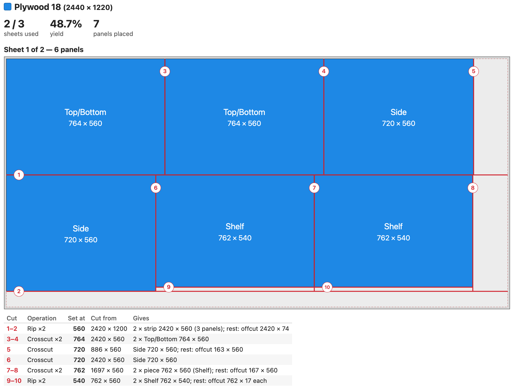
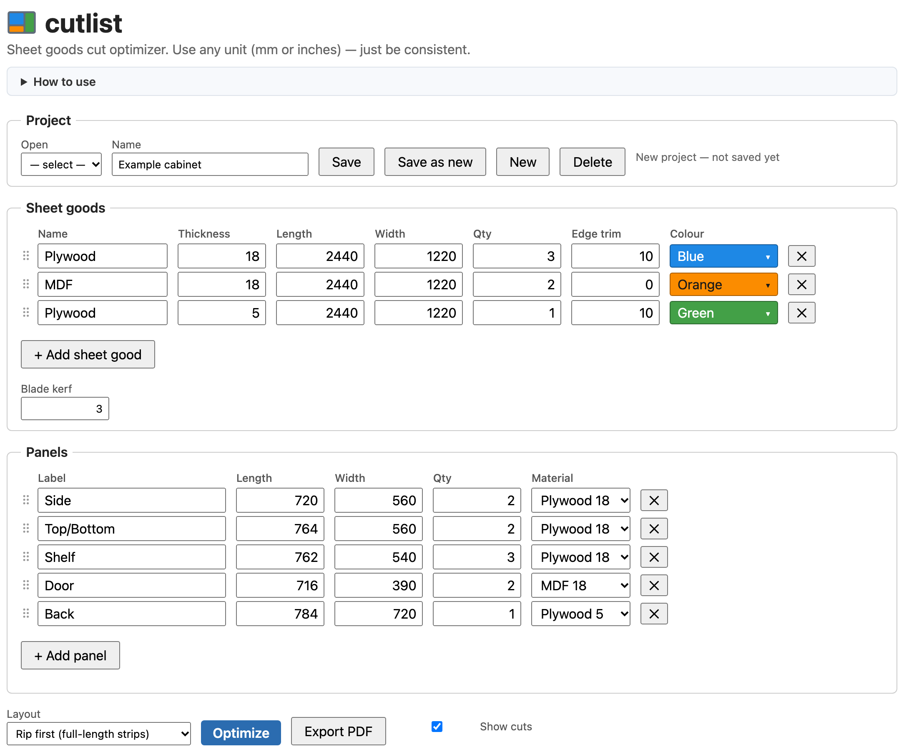
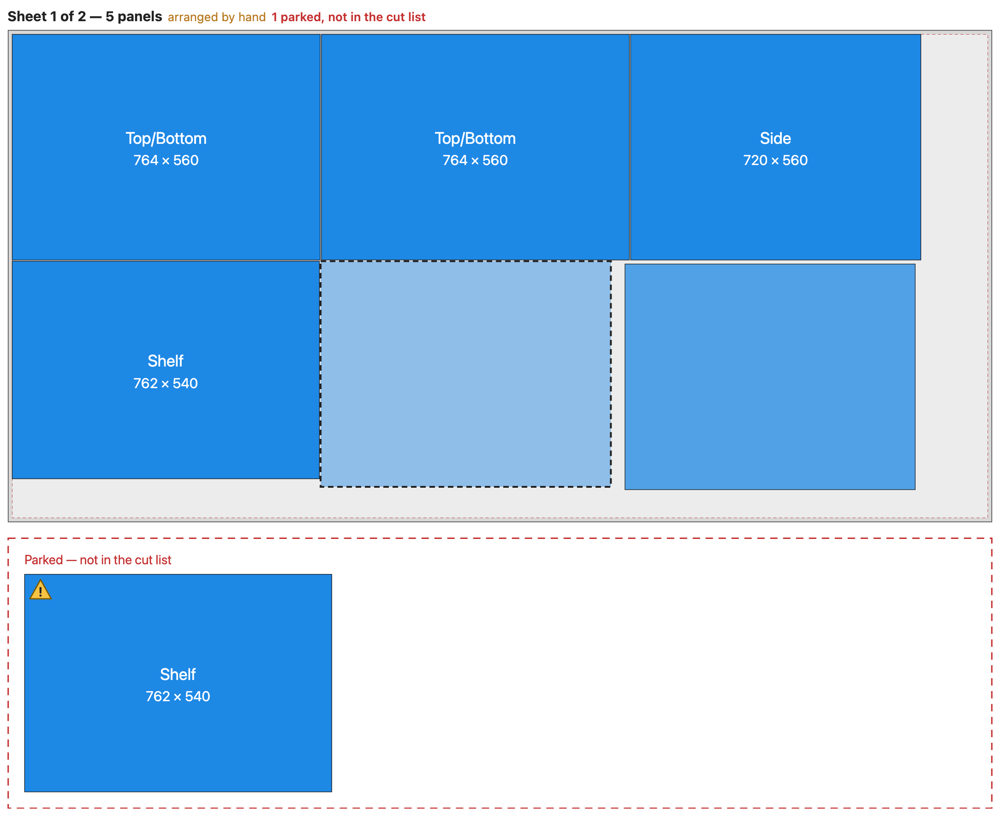

<p align="center">
  
</p>

<h1 align="center">cutlist</h1>

<p align="center">
  <strong>A free, open-source cut optimizer for sheet goods.</strong><br>
  Plan how to cut plywood, MDF and other panels with the least waste, then take a clear cut list to the saw.
</p>

<p align="center">
  <a href="LICENSE"></a>
  
  
</p>

<p align="center">
  
</p>

---

## Why I built this

I have a furniture project coming up, with a lot of panels to cut from a few sheets of plywood and MDF. Before buying material I wanted to know how many sheets I really need, how to lay the panels out, and in what order to make the cuts.

I looked for a tool online and could not find a free one that did what I needed. Some were paid, some locked features behind an account or a subscription, and others produced layouts that can't be cut on a real saw or left out what matters in the workshop: blade kerf, trimming the factory edges, the cut order and the fence settings.

So I built my own. **cutlist** is free, open source and yours to copy, change and share (see [License](#license)).

## Features

- **Several sheet goods at once**: each with its own size, thickness, stock quantity, edge trim and colour.
- **Real-world cutting**: blade kerf, edge trim, and panels that may be turned 90° to fit.
- **Three layout styles**, all guillotine-cuttable (every cut runs edge to edge):
  - *Rip first*: full-length strips, then crosscuts. Ideal for a table saw.
  - *Crosscut first*: full-width strips. Handy with a track saw or a sliding table.
  - *Best fit*: free packing for the best yield.
- **Numbered cut lines in saw order**, and a **cut list per sheet** with the fence setting for each cut. Identical consecutive cuts are grouped, so you can cut them at one setting.
- **Rearrange by hand**: drag a panel to another place on its sheet and the rest re-pack around it, staying cuttable. Press <kbd>R</kbd> to turn it, or <kbd>P</kbd> to park it beside the sheet while you sort out the others.
- **Measuring tool** on the diagrams, snapping to corners, cut-line junctions and the trim lines. Hold <kbd>Shift</kbd> to measure straight across.
- **Formulas in number fields**: type `=600-2*18` instead of working it out yourself.
- **Projects** saved locally in SQLite, including any arrangement you made by hand.
- **PDF export** for the workshop: inputs, layouts and cut lists, as shown on screen.
- **Any unit**: mm or inches. Just stay consistent.

<table>
  <tr>
    <td width="50%"></td>
    <td width="50%"></td>
  </tr>
  <tr>
    <td align="center"><em>Enter your sheet goods and the panels you need</em></td>
    <td align="center"><em>Rearrange by hand; parked panels wait below the sheet</em></td>
  </tr>
</table>

## Getting started

You only need [Node.js](https://nodejs.org/) **22.13 or newer**. There is nothing to install: no packages, no build step.

```sh
git clone https://github.com/USERNAME/cutlist.git
cd cutlist
npm start
```

Then open **http://localhost:3000**.

| Command | What it does |
|---|---|
| `npm start` | Runs the app |
| `npm run dev` | Runs it and restarts when the server code changes |
| `npm run debug` | Same as `dev`, with the Node inspector |

Settings, through environment variables:

| Variable | Default | Purpose |
|---|---|---|
| `PORT` | `3000` | Port to listen on |
| `DB_PATH` | `data/cutlist.db` | Where projects are stored (SQLite file) |

## How to use it

1. **Sheet goods**: add each material you have, with its size, the number of sheets and the edge trim (the strip cut off each edge to square it up). Set the blade kerf.
2. **Panels**: list every part with its label, length, width, quantity and material.
3. Pick a **layout** and click **Optimize**.
4. Check the diagrams and cut lists. Drag panels around if you prefer another arrangement, and measure anything you want to double-check.
5. **Save** the project and **Export PDF** for the workshop.

The page has a **How to use** section at the top with all the details and keyboard shortcuts.

## How it works

- **Layouts.** For each material, the optimizer tries several variants of the chosen strategy (different sort orders and orientations) and keeps the best: fewest panels left over, then fewest sheets, then the largest reusable offcut.
- **Cut sequence.** The cuts are recovered from the finished layout: first the full-length (or full-width) cuts across the whole sheet, then, inside each strip, the cuts the other way, and so on. Each cut gets its number, its fence setting and what it produces.
- **Manual arrangement.** A sheet is kept as a *cut tree* (strips, then pieces, then panels). Moving a panel takes it out of the tree, tries every place it could be inserted, packs each candidate toward the top-left corner with a kerf between neighbours, and keeps the one nearest to where you dropped it. That's why every arrangement you make can still be cut edge to edge.

## Project structure

```
server.js          Node http server: static files + a small JSON API for projects
db.js              Project storage with the built-in node:sqlite
public/
  index.html       The whole user interface (HTML, CSS and script, no framework)
  optimizer.js     Layout algorithms, cut sequence and cut list
  arrange.js       Drag-and-drop rearrangement on the cut tree
  formula.js       Small hand-written arithmetic parser for number fields
  pdf.js           Minimal PDF writer and the report layout
  favicon.svg      The logo
```

The project has **zero dependencies** on purpose: plain HTML and JavaScript in the browser, and only Node's built-in modules on the server. It's easy to read, easy to run and has nothing to keep up to date.

`REQUIREMENTS.md` keeps what each iteration delivered, the backlog and the decision log.

## Contributing

Ideas, bug reports and pull requests are welcome. Please keep the zero-dependency spirit: if a change needs a package, open an issue first so we can discuss it.

## License

Released under the [MIT License](LICENSE). You are free to use, copy, modify, merge, publish, distribute, sublicense and sell copies of it. Just keep the copyright and license notice.
